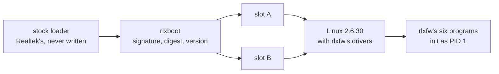

# rlxfw

 

An independent firmware for the TOTOLINK N150RT, a router built on the Realtek RTL8196E — a big-endian
Lexra core, 4 MiB of SPI flash, 32 MiB of RAM — whose vendor never released its source. It is built from
GPL drops of Realtek's SDK and a leaked draft datasheet, on one unit with no spare.

**Measured on the device.** Release [`v1.0`](https://github.com/Jhongwe1/router-customFW/releases/tag/v1.0)
boots from a flash slot through `rlxboot`, rlxfw's signed-update verifier, and pings both ways. `rlxboot` refused a
payload with one bit flipped and a version below its counter, and ten power cuts during slot writes each booted
the other slot. rlxfw's own drivers carry the Ethernet, and its six programs run privilege-separated.

**Not established.** The device cannot update itself, its configuration is lost at power-off, and the
serial console opens a root shell without a login. The full list is [`docs/KNOWN-ISSUES.md`](docs/KNOWN-ISSUES.md);
what was found along the way is [`docs/FINDINGS.md`](docs/FINDINGS.md).

**To check it.** `make test` runs the host suites CI runs on every push to `main`, and the claims about the
device trace to console captures committed unedited under `bench/`.

## What works

Measured on the device unless the row says otherwise. Each gate's result, with what it does not establish,
is indexed in [`docs/reports/README.md`](docs/reports/README.md); how the parts fit is [`docs/architecture.md`](docs/architecture.md).

| Layer | rlxfw's own | Measured | Gate |
|---|---|---|---|
| Boot | `rlxboot`, a second-stage loader: Ed25519 over the header, SHA-256 over the payload, an anti-rollback version, two slots and a read-only rescue copy | boots slot A or B from flash; refused a flipped payload bit and a lower version; ten power cuts mid-write each booted the other slot | `R8a`, `R8b` |
| Kernel | eight drivers on the vendor's Linux 2.6.30 — timer, GPIO, buttons, watchdog, SPI flash, Ethernet DMA, switch, entropy — and no vendor Ethernet driver in the image | the release image boots from flash and pings both ways, after a watchdog reset and after a cold power-on | `R5`, `R6`, `R6b`, `R6c` |
| Userspace | six programs: `init` as PID 1, a config store, a privileged broker, a web server, a DNS forwarder, a DHCP-lease handler; busybox rebuilt to a chosen applet set | booted from RAM, each answered: `httpd` as uid 100 in a chroot, `dnsfwd` as uid 101 | `R7` |
| Instruction set | a bare-metal census under rlxfw's own exception handler | 75 encodings on the die; it executes `lwl`, `lwr`, `swl` and `swr`, which its family's public record says it lacks | `R1-pub` |
| Production test | `mfgtest`, eleven checks | 11 of 11 on a good unit; five checks turned red by physical fault injection | `P1` |
| Comparison | one instrument run on both firmwares | 16 published rows against the vendor firmware, each with a mechanism class and a check that would show the opposite | `R9` |
| Build, on a host | the kernel configuration, every change to vendor source and the initramfs, each declared in a table | the same tree built twice gives the same image, on one machine | `P4a` |
| Release, on a host | the image and its signed container, beside the corresponding source and the licence texts | the image is the bytes the device ran; the source archive built twice, byte-identical | `P4b` |

## What does not work

- The device cannot update itself: every slot write was made by an install image started from RAM at the
  loader's prompt, and the anti-rollback counter has never advanced.
- Nothing the running firmware writes survives a power cycle; the config store is in RAM.
- The console opens a root shell without a login; nothing serves TLS; the WLAN driver is the vendor's.
- There is no WAN: switch ports 0–5, the jack labelled WAN among them, share one VLAN.
- None of it is secure boot: whoever can write the flash can replace `rlxboot`. Every reading of the release
  image is one unit, one loader build and one boot per path ([`docs/KNOWN-ISSUES.md`](docs/KNOWN-ISSUES.md)).

## Numbers

| | |
|---|---|
| Release image | 1,110,016 bytes; a slot holds 1,179,648 |
| Kernel boot, cold | rlxfw 9.4 s, the vendor's 7.1 s; the vendor's userspace then takes 18.7 s (`P2`, one script for both) |
| TCP through rlxfw's Ethernet driver | 16.9 Mbit/s received by the board, 21.6–22.4 sent, three runs each (`R6b`); the vendor's driver on the same kernel, 24.6 and 26.1 (`P2`) |
| Traffic with no stall | 31 minutes, 2,363,511 frames of every length from 60 to 1,514 bytes; the driver's recovery fired 0 times (`R6b`) |
| Power cuts during a slot write | 10 of 10 booted the other slot (`R8b`) |
| Methods and repetitions | [`docs/boot-time-table.md`](docs/boot-time-table.md); [`notes/nic-driver.md`](notes/nic-driver.md) § 28 |

## Build and flash

`make test` builds the six programs and their tests with the host's gcc and clang, runs them plain and
under ASan and UBSan, then runs `rlxboot`'s host suite; it is what CI runs on every push to `main`. `make userspace`
and `make image` need the vendor's GPL drop at its pinned commit, which is not in this repository. What
each goal needs, and what has been run that way: [`docs/build.md`](docs/build.md). Writing the flash is
not a `make` goal; which regions may be written, and under whose yes, is [`docs/flash.md`](docs/flash.md).

## Repository map

| Path | What it holds |
|---|---|
| [`kernel/`](kernel) · [`src/`](src) | rlxfw's own kernel files, its drivers among them · the six programs, their shared code, `rlxboot` and the fuzz harnesses |
| [`config/`](config) · [`tools/`](tools) | every other build input, declared · the instruments that build, drive the bench, check and count |
| [`docs/`](docs) · [`notes/`](notes) | entry pages, reports, decisions and a page per driver, from [`docs/README.md`](docs/README.md) · an engineering note per subsystem |
| [`bench/`](bench) · [`qemu/`](qemu) · [`dt/`](dt) · [`srv/`](srv) · [`refs/`](refs) | every console capture, unedited, with the bench cards · emulator runs, which are not measurements · device-tree bindings · the pages `httpd` serves · where the uncommitted datasheets go |
| [`upstream/`](https://github.com/Jhongwe1/router-firmware-re) | the reverse-engineering project, the comparison's baseline, pinned read-only at `4d3ff26` |
| `SPEC.md` · `PROGRESS.md` · `LOG.md` · `CHANGELOG.md` | every number held about the device, in Chinese ([English entry](docs/spec/README.md)) · where the work is · the log, in Chinese · what each release contains |

## How it was verified

Every sentence about the device carries a mark: 量 measured on this unit, 讀 read out of code or a dump, 推
inferred and waiting for a measurement. A result counts only if the condition that would refute it was written
first, and a bench card's predictions are written before power. Every instrument here ships with the controls
that show it can fail, because a tool reporting 0 is making a claim. Two workflows run on every push to `main`: `build`
runs the host suites, and `instruments` the tools' self-tests, their mutation suites and the text checks. The
rules are [`CLAUDE.md`](CLAUDE.md)'s; the reader's version is [`docs/method.md`](docs/method.md).

## Hardware

| | |
|---|---|
| Board and console | TOTOLINK N150RT, one unit, no spare; a serial console at 38400 8N1 through a CP2102 adapter; Realtek's loader at `0x000000`, never written |
| SoC and core | Realtek RTL8196E; Lexra `RLX4181`, `PRId` `0x0000CD01` measured. The name is read from a table in the vendor's kernel headers: one header copied three times, read by no code, and encoded so that it breaks for `0xdc01` and `0xdc02` |
| Memory | big-endian; 32 MiB SDRAM, 26,052 kB of it given to Linux; 4 MiB SPI NOR flash |
| Caches | I-cache 16 KiB, two-way; D-cache 8 KiB; 16-byte lines; the D-cache is not coherent with DMA |

## How it was built

**Tools.** The code, the tools and the documents were written with Claude Code, Anthropic's coding agent, in sessions
the author directed, under the rules in [`CLAUDE.md`](CLAUDE.md), which only the author changes. CI runs on GitHub Actions.

**Division of work.** The author owns the hardware and every physical act at the bench: each power cycle, each button
press, each visual reading of an LED. Each flash write is authorised by the author in writing for that exact payload,
and the tools refuse one without it (`FW-113`). The author opens each gate, sets its scope, time and risk, and decides
every act outside the repository: each push, tag, release and report. The agent proposes, writes and measures; a claim
reaches a committed file only with its source marked and its refutation condition written first.

**Five defects the author caught**, each opened by what the author said:

1. *"Should those four be re-tested, or did I misread them?"* The card's counting identities missed a
   factor of 2: on this core one `cat` of a `/proc` file is two `read_proc` calls (`FW-64`).
2. *"Can't you read the dump and work out the engine?"* The proposed deeper transmit ring had no basis: the
   loader drives the same four entries without stalling, and then served as the test bench for a
   one-variable comparison (`NET-98`) and for the ring's recovery path (`NET-101`).
3. *"Is it the watchdog?"* The two-by-two built to answer it put the failure on the loader's path, not the
   reset: booted from flash, the loader skips the switch's VLAN setup (`NET-171`, `NET-173`).
4. *"The comments keep piling up, like tape."* `CLAUDE.md` had grown from 81 to 1,450 lines; the documents
   were split into state, record and finding, with size budgets (`FW-112`).
5. *"I don't see your `v0.4` release on GitHub."* The tag was pushed and the release never made, for the
   second time; the closeout audit asked which file owns each result, and a release is not a file.

## Versions

This table owns which gates define each version; `PROGRESS.md` owns which have shipped, `CHANGELOG.md` their contents.

| version | the gates that define it | version | the gates that define it |
|---|---|---|---|
| `v0.0` | the instruments and the desk analysis | `v0.4` | `R1-pub` + `P1` |
| `v0.1` | `R0` + `rlxprobe` executing on the silicon + `R1-gate` | `v0.5` | `R6` + `P2` |
| `v0.2` | `R3`, with a 60-second take + `P4a` | `v0.6` | `R7` |
| `v0.3` | `R4` + `R5` | `v1.0` | `R6c` + `R8` + `R8b` + `R9` + `P3` + `P4b` |

## Licences

[`LICENSE`](LICENSE) is the MIT text and covers rlxfw's own userspace, tools and documents; [`kernel/LICENSE`](kernel/LICENSE)
covers rlxfw's own kernel files, which are `GPL-2.0-only` because the kernel they link into is. [`NOTICE`](NOTICE) says
what is under which licence and why, and [`docs/offer.md`](docs/offer.md) how corresponding source travels: as an asset
of the same release as the binary. `v0.2`–`v0.6` carry no binary; `v1.0`'s binaries travel only with their
corresponding-source archive. No vendor material is committed: `SOURCES.json` records every external input with its
URL and sha256, and the flash dump, which identifies this unit, stays out.
