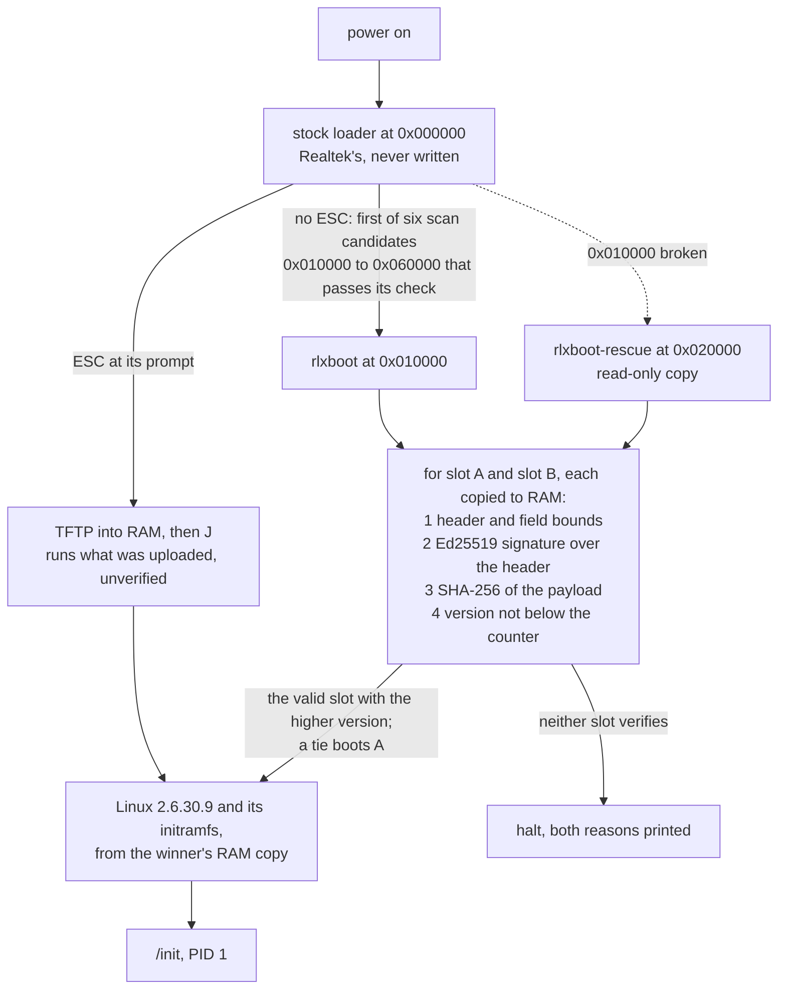
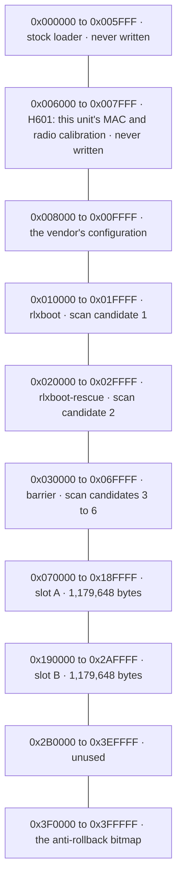
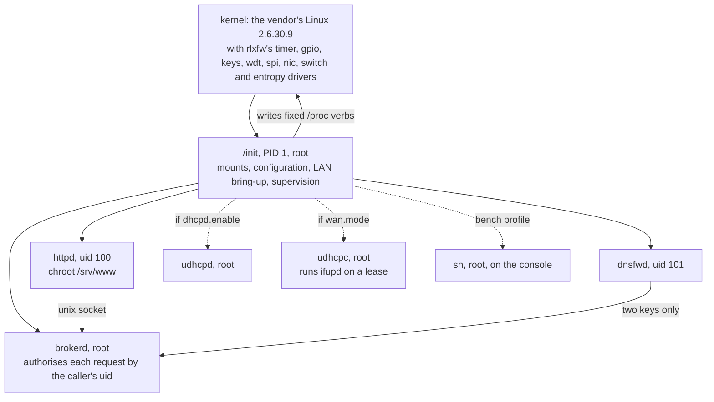

# Architecture

How rlxfw boots, where it sits in the flash, and what runs on it with which
privileges, in three diagrams. Each diagram is a reading of the files linked
under it, which own the facts and win wherever the two disagree. Marked as the
rest of the repository is: **量** measured on this unit, **讀** read out of code
or a dump, **推** inferred, pending a measurement.

## Boot and trust chain

讀 The stock loader checks a header and a 16-bit sum and nothing cryptographic;
it boots the first of its six candidates that passes, so `rlxboot` and its rescue
copy sit at the first two, and the slots carry no header the loader accepts: the
only way into a slot is through the signature check ([`flash.md`](flash.md) § *The
loader scans*). 讀 `rlxboot` stops at the first failed check, and hashes the
payload only after the header's signature verifies
([`notes/update-chain.md`](../notes/update-chain.md) § 2). 量 From flash it booted
slot A or B, chose the higher of two valid versions, handed over to the rescue
copy when its own region was torn, and booted the other slot after each of ten
power cuts during a slot write (`FW-241`–`FW-243`); 量 from RAM it refused a
container with one payload bit flipped and one whose version was below the
counter (`FW-170`, `FW-171`). The selection rule is
[`notes/rlxboot.md`](../notes/rlxboot.md), *D4's rule, as the code does it*.

The prompt path is how every image was booted until `R8b`, and how the image
that writes the slots is still started: it skips `rlxboot` entirely. None of
this is secure boot: whoever can write the flash can replace `rlxboot` itself
([`flash.md`](flash.md) § *`rlxboot`*). Why two slots and a rescue copy:
[ADR-002](decisions/ADR-002-ab-slots-rlxboot.md).

## Flash layout

讀 The binding constraint on the layout is the loader's scan table, not the
4 MiB: with slot A at `0x030000`, four of the six candidates would fall inside
it, and a slot whose bytes happened to form an accepted header would boot without
`rlxboot`, so the four sit in a barrier between `rlxboot-rescue` and slot A
(`FW-167`, [`notes/update-chain.md`](../notes/update-chain.md) § 6). 量 The
barrier was not erased before `R8b` (`FW-225`); that gate's seating erased it
after slot A's first write, and the install path read it back
([`bench/2026-10-07/`](../bench/2026-10-07), `W4b`). A slot holds one container:
a 160-byte signed header and the kernel image with its initramfs. The rules for
each range, and why the first two are never written, are [`flash.md`](flash.md)'s;
量 the counter has never advanced (ADR-002), and a rollback is not refused from
flash ([`KNOWN-ISSUES.md`](KNOWN-ISSUES.md)).

## Processes and privileges

讀 `/init` starts every child with `fork` and `execve`, an argv of string
literals and a fixed environment; no argv byte comes from the configuration, a
lease or the kernel command line, and neither `init` nor `ifupd` contains a
`system`, `popen` or `sh -c` ([`notes/init.md`](../notes/init.md) § 4). 讀
`brokerd` reads each caller's uid from the socket (`SO_PEERCRED`) and checks it
against one table: without a session `httpd` may log in and read three status
rows, and every other request needs one; `dnsfwd` may read `dns.upstream` and
`lan.ipaddr` and nothing else ([`notes/broker.md`](../notes/broker.md) § 2). 量 On the die, `httpd` ran as
uid 100 in its chroot and `dnsfwd` as uid 101, which proves its drop by calling
`setuid(0)` and requiring the call to fail; the console shell is root and is
started by `/init`, not by a login (`FW-175`,
[`notes/userspace-integration.md`](../notes/userspace-integration.md) § 7.2).
Each driver has a page, listed in [`docs/README.md`](README.md), and the programs
are indexed in [`src/README.md`](../src/README.md).

## What this page does not establish

- **That the diagrams are complete.** Each shows what its section names; the
  vendor's own kernel code in the image, its WLAN driver among it, is in
  [`sbom.md`](sbom.md).
- **Anything its owners do not.** No reading was taken for this page; where it
  and an owner differ, the owner is right and this page is stale.
- **That the userspace was read under load.** 量 `R7` asked each program one
  question on one boot from RAM.
